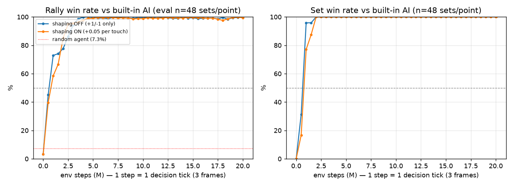
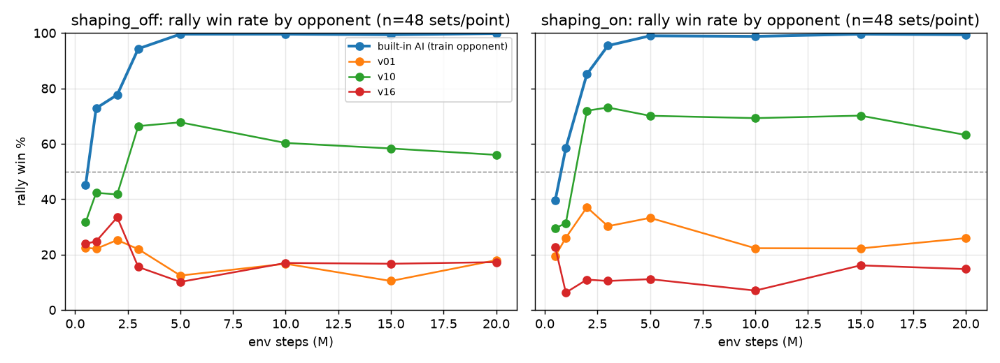
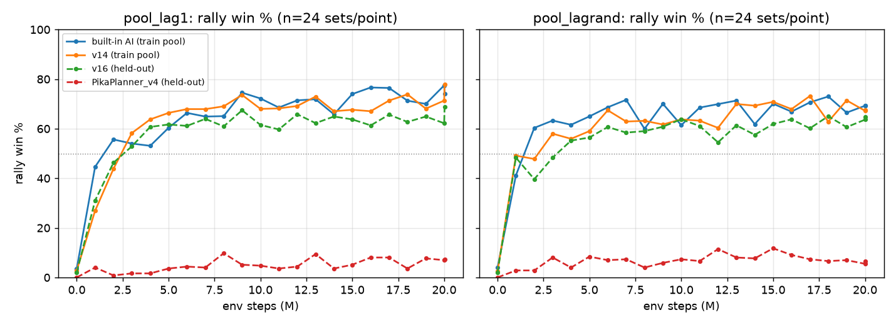
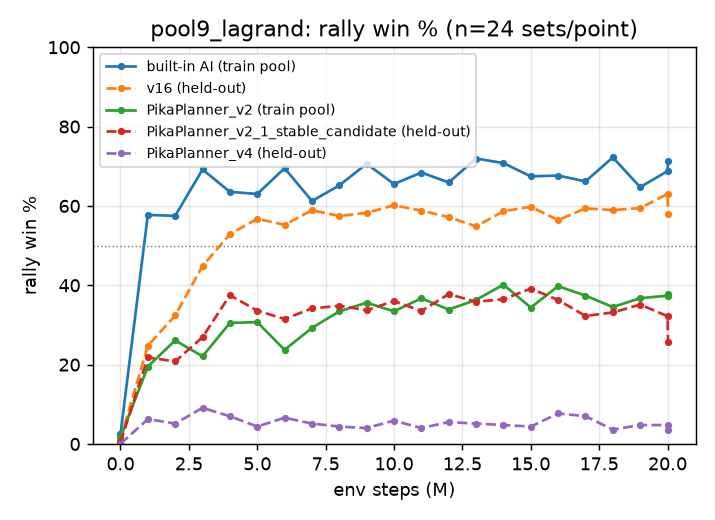

# RL 에이전트 vs 룰 기반 봇

목적: 강한 봇을 만드는 것이 아니다. 기존 오프라인 하네스 위에 **학습 환경을 만들고, 에이전트를 붙이고,
룰 봇(v1~v16)과 같은 프로토콜로 공정하게 평가하는 것**이다. RL이 룰 봇보다 약해도 그 원인 분석이 산출물이다.

기여 범위: 게임 엔진(대회 운영측)과 `arena/` 하네스, 평가에 쓴 봇들(LuckyPunch v01~v16, PikaPlanner 계열 등)은 이 실험 전부터 있던 것이다.
`rl/` 전체와 이 문서는 이 실험을 위해 새로 작성했다.

## 요약
- **환경**: 실제 게임 엔진을 결정 tick(120ms) 단위로 감싼 Gymnasium/SB3 환경을 만들었다. 기존 오프라인 하네스와 점수·프레임이 72/72 일치한다.
  룰 봇과 같은 정보·같은 반응 지연·같은 측정 프로토콜(상대당 96세트, 양 진영, 지터 {0,8})을 쓴다.
- **1차 (내장 AI만 상대로 PPO 학습)**: 내장 AI는 랠리 100%로 완파했지만, 평가 9종 평균 세트 승률은 43%로 룰 봇 v16(65%)에 크게 뒤졌다.
  진단 결과는 이렇다. 내장 AI 상대가 포화한 뒤 다른 상대 성능이 오르지 않았고, 상대 공을 못 받아서 졌다. 원인은 **단일 상대 과적합**이다.
- **2차 (상대 풀 7종으로 학습, v16·PikaPlanner_v4 홀드아웃)**: 평가 9종 평균이 **87~88%** 로 v16(65%)을 넘었다. 홀드아웃 v16도 97~100%로 이긴다.
  추가 홀드아웃 16종 평균도 67~68%로 v16(56%)보다 높다(모두 실측 지연 lag 1 기준).
  지연 무작위화를 넣은 모델은 lag 3 성능이 크게 좋아졌다(확장 평가 56% → 78%).
- **남은 실패**: PikaPlanner v2 이후 계열과 skill-example에는 lag 1에서 0~8%다. 진단해 보면 수비는 좋아졌지만 공격 성공률이 0.4%다.
- **3차 (이 계열 일부를 학습 상대에 추가)**: lag 1에서는 학습 상대로 넣은 PikaPlanner_v3조차 3%로, 여전히 못 뚫었다.
  하지만 lag 2~3에서는 홀드아웃 PikaPlanner_v4(lag 3: 20%→74%)·v2_1(lag 2: 30%→76%)까지 뚫렸다.
  코드를 보니 이 계열은 모두 `ACTION_LATENCY: 1`, 즉 반영 지연 1프레임을 가정하고 엔진을 시뮬레이션해 수비한다.
  실측 지연(lag 1)과 정확히 맞을 때만 견고한 플래너다.
- **한계**: 학습 시드는 조건당 1개, 하이퍼파라미터는 SB3 기본값, 스킬이 없는 조건이다.

## 1. 환경 설계

### 구조
- `rl/pika_env.mjs`: 엔진을 감싼 코어. `arena/arena.mjs`의 `playSet()` 루프를 그대로 따르되,
  **에이전트의 결정 tick마다 generator가 `yield`** 해서 바깥에 행동을 묻는다.
  `arena`는 수정하지 않았고 `loadBot`·`makeRng`·`PikaPhysics`·`setCustomRng`만 import한다.
- `rl/env_server.mjs`: stdin/stdout 줄 단위 JSON 서버. **한 프로세스가 N개 게임을 배치로 진행**한다.
  `step` 한 번에 N게임이 한 step씩 진행되므로 IPC 비용이 N게임에 분산된다.
- `rl/pikarl/env.py`: Python 쪽. `PikaEnv`는 Gymnasium Env로 게임 1개를 맡는다(검증용).
  `PikaVecEnv`는 SB3 VecEnv로 N게임을 맡고 끝난 게임은 자동으로 리셋한다(학습용).

### 설계 결정과 근거
| 결정 | 근거 |
|---|---|
| 1 step = 에이전트 결정 tick 1회 (3프레임) | 대회 봇이 `decide`를 받는 주기와 같아야 비교가 공정하다. 프레임 단위로 행동하면 룰 봇보다 3배 자주 반응하는 셈이다 |
| 반영 지연 `lag` 적용 (기본 1, 설정 가능) | 결정은 `frame + lag`에 반영된다. arena `BotSide`와 같은 규칙이며, 실측 지연이 1이다 |
| 정지 구간에도 결정을 요청하고, 관측에 `frozen` 플래그를 넣음 | 실제 게임도 정지 구간에 `decide`를 부른다. 이 구간의 점프는 서브를 통째로 놓치게 만든다(CLAUDE.md 함정). 이것도 학습할 대상으로 남겼다 |
| 관측은 스냅샷 + 직전 스냅샷과의 차이 + 직전 행동만 사용 (37차원) | **룰 봇과 정보 조건을 맞추려는 것이다.** 봇이 `decide` 안에서 알 수 있는 것(스냅샷, 스스로 기억한 직전 값) 밖의 정보, 예컨대 접촉 횟수나 엔진 내부 상태는 넣지 않았다 |
| 직전 행동을 관측에 넣음 | lag 동안은 직전 행동이 아직 적용 중이다. 이걸 모르면 상태가 마르코프가 아니다 |
| RIGHT 진영이면 x축 미러링 (x→432−x, vx·divingDirection·행동 x 부호 반전) | 정책 하나로 양 진영을 커버하기 위해서다. 엔진은 좌우 대칭이다(벽 반사도 대칭화된 버전) |
| 행동 Discrete(18) = x{-1,0,1} × y{-1,0,1} × hit{0,1} | `decide` 반환값 공간과 정확히 같다. 점프·다이빙·파워히트 각도는 엔진의 파생 규칙에 맡긴다 |
| 보상: 득점 +1 / 실점 −1 | 평가 지표(랠리·세트 승률)와 일치한다 |
| 셰이핑(선택): 내 공 접촉마다 +0.05 | 랜덤 정책의 랠리 승률이 7%라 보상이 희소하다. 계수는 랠리 1점의 1/20로 잡았다. 한 진영 최대 4회 접촉이 가능해도 합이 0.2라 득점 보상을 넘지 않는다. 다만 자기 코트에서 계속 튀기기를 부추길 수 있어 ON/OFF를 둘 다 학습한다 |
| 에피소드 = 1세트(10점 선착) | 대회 매치 단위와 같다. 4000프레임 무승부 랠리는 arena와 같이 점수 없이 넘어간다 |
| 엔진 RNG를 게임별 스트림으로 교체 | `rand.mjs`의 `setCustomRng`는 프로세스 전역이다. 배치로 돌리면 게임 간 난수가 섞이므로, 매 step 직전에 그 게임의 RNG로 바꿔 끼운다 |
| 상대 봇의 `Math.random`을 시드 고정 | v07·v09·v10·v11은 `Math.random`을 쓴다. 고정하지 않으면 같은 시드로도 재현이 안 된다. 엔진 RNG와는 별도 스트림을 써서, 상대가 바뀌어도 엔진 난수열은 그대로 유지된다 |
| 상대 봇은 게임(세트)마다 새 vm 컨텍스트에 로드 | 대회에서는 "매치당 파일 1회 실행"이다. 전역 상태가 세트 사이로 새지 않게 했다 |

## 2. Phase 1 검증 (2026-10-13)

환경: Windows 11, Node v24.20.0, Python 3.13.2, CPU 논리 코어 12개.

- **arena 하네스와의 동일성** (`node rl/tests/parity.mjs 3`): 에이전트 슬롯에 v16의 `decide`를 그대로 꽂고
  `playSet()`과 비교했다. 조합은 상대 {AI, v03, v16} × 진영 {L, R} × lag {1, 3} × 지터 {0, 8} × 시드 3개다.
  **72/72 조합에서 최종 점수와 총 프레임 수가 일치했다.**
- **Gymnasium `env_checker`, SB3 `check_env`**: 통과.
- **재현성**: 같은 시드와 같은 랜덤 행동열로 **별도 프로세스에서 두 번** 돌렸다. 관측·보상 해시가 일치했다
  (상대 AI·v10·v16 × 양 진영 = 6/6). 시드를 바꾸면 해시도 달라진다.
- **처리량** (랜덤 행동, 8초씩 측정):

  | 구성 | 상대 | steps/s |
  |---|---|---|
  | PikaEnv (1게임, 1프로세스) | AI | 14,536 |
  | PikaVecEnv n=8 | AI | 45,775 |
  | PikaVecEnv n=32 | AI | 70,447 |
  | PikaVecEnv n=64 | AI | 77,986 |
  | PikaVecEnv n=8 / 32 / 64 | v16 | 7,436 / 7,785 / 7,760 |

  v16이 상대일 때는 v16 자체의 `decide` 연산(롤아웃 탐색)이 병목이다. 배치 크기와 무관하게 약 7.7k에서 멈춘다.
- **평가 상대 13종 스모크 테스트** (`node rl/tests/opponents.mjs`): 대상은 AI, LuckyPunch v01·v03·v10·v16,
  PikaPlanner v1·v2·v2_1·v3_netfront·v4·tuned_v1·tuned_v1_reference, submit_v1이다.
  전부 로드되고, 같은 시드로 두 번 돌리면 결과가 같으며, `decide` 예외는 0건이다.
  - 세트당 시간(랜덤 에이전트 기준): PikaPlanner v2·v2_1·v3·v4와 submit_v1은 0.9~1.4초, 나머지는 0.1초 이하다.
    무거운 상대는 학습 상대로 쓰기 어렵고 평가 전용으로 써야 한다.
  - `submit_v1.js`는 `PikaPlanner_v4.js`와 클로 스킬 발동 조건 두 줄만 다르다. v4는 `hit=1`일 때만 `skillX`를 붙이고,
    submit_v1은 항상 붙이며 LEFT 기준 목표 x도 100→130으로 바뀌었다.
    실제 게임(`src/resources/js/skill/`)에는 게이지와 클로 스킬이 있으므로 두 봇은 실전에서 다르게 동작한다.
    하지만 **arena 하네스와 이 RL 환경은 스킬을 구현하지 않는다.** `physics.js`만 복제했고, `sanitize`가 `skillX`를 버리며,
    스냅샷에 `gauge`·`claw`가 없다. 그래서 **오프라인에서는 두 봇의 결과가 같다**(arena 4세트 결과도 숫자까지 일치).
    LuckyPunch v1~v16은 스킬을 쓰지 않는다(v12~v16의 `gauge`는 주석에만 나온다).
    `PikaPlanner_tuned_v1`과 `_reference`는 바이트 단위로 같은 파일이다.
  - 참고(n=4세트, 소표본): 에이전트 슬롯에 v16을 꽂으면 PikaPlanner v2_1·v4와 submit_v1에 1~2점밖에 못 낸다.
    arena `run.mjs`로 직접 돌려도 0-4로 같다. 환경 버그가 아니라 실제 전력 차이다.
    이 상대들은 v16 문서의 비교 풀에 없었다.
  - **Phase 3 평가 상대 확정 (9종)**: 내장 AI, LuckyPunch v01·v05·v07·v10·v12·v14·v16, PikaPlanner_v4.
    v05·v07·v12·v14도 같은 스모크 테스트를 통과했다(재현 OK, 예외 0).
    내장 AI는 학습 상대이자 기준선이라 포함했다.
  - **평가는 스킬 없는 조건으로 한다.** 근거: 기존 v1~v16의 측정이 모두 이 조건이었고,
    arena와의 패리티 검증(72/72)이 성립하는 조건도 이것뿐이다.
    대가로 PikaPlanner_v4의 클로 공격과 회피 로직은 꺼진 상태로 평가된다. 이 점은 한계로 5절에 적는다.
    submit_v1은 이 조건에서 PikaPlanner_v4와 결과가 같으므로 평가에서 뺐다.
- **랜덤 에이전트 vs 내장 AI** (lag 1, 지터 0/8 각 24세트, 진영 반반, n=48세트):
  세트 **0/48**, 득점 38−480, 랠리 승률 **7.3%** (n=518랠리). 이 수치가 학습 전 기준선이다.

## 3. 학습 (Phase 2)

### 설정
| 항목 | 값 | 근거 |
|---|---|---|
| 알고리즘 | SB3 PPO, `MlpPolicy`, **하이퍼파라미터는 SB3 기본값** (n_steps 2048, batch 64, epochs 10, lr 3e-4, γ 0.99, 64×64 MLP) | 지시대로 기본값에서 시작한다. 튜닝 없이도 학습이 되는지 보는 것이 먼저다 |
| 병렬 | `PikaVecEnv` 16게임 (Node 프로세스 1개), CPU | 1회 업데이트에 32,768 스텝이 모인다. MLP는 GPU 이득이 없어 CPU를 쓴다 |
| 상대·조건 | 내장 AI, lag 1, 지터 8, 진영은 에피소드마다 교대 | 평가 조건(lag 1)과 같다. 지터는 같은 출발 상태만 외우는 것을 막는다 |
| 길이 | 조건당 2,000만 스텝 (= 약 667시간 분량의 게임 시간, 1스텝 120ms) | 시험 학습에서 동시 2개 기준 속도를 보고 정했다 (아래) |
| 주기 평가 | 50만 스텝마다. 결정론적 정책으로 내장 AI 상대 48세트 (평가 전용 시드 12개 × 지터 {0,8} × 양 진영) | 학습 시드와 겹치지 않는 대역(9억~)을 쓴다. 체크포인트도 같은 주기로 저장한다 |
| 조건 | 셰이핑 OFF(득점 ±1만) / ON(+접촉당 0.05) | 희소 보상이 문제인지 따로 보기 위해서다 |

시험 학습(셰이핑 OFF, 23만 스텝, 평가 포함 약 2,300 steps/s): 내장 AI 상대 랠리 승률이 3.2%에서 19.9%로 올랐다(n=48세트).
학습 신호가 있다는 것을 확인했다.

### 결과

두 조건 모두 2,000만 스텝을 완주했다. 걸린 시간은 각각 7,244초(ON)와 7,263초(OFF)로, 동시에 실행해 조건당 약 2,750 steps/s가 나왔다.
아래 수치는 모두 내장 AI 상대 주기 평가이며 시점마다 n=48세트다.

| 스텝 | OFF 세트 / 랠리 | ON 세트 / 랠리 |
|---|---|---|
| 50만 | 31% / 45% | 17% / 40% |
| 100만 | 96% / 73% | 77% / 58% |
| 200만 | 100% / 78% | 100% / 85% |
| 300만 | 100% / 94% | 100% / 95% |
| 500만 | 100% / 99.6% | 100% / 99.0% |
| 2,000만 | 100% / 99.8% | 100% / 99.4% |

| 도달 시점 | OFF | ON |
|---|---|---|
| 세트 승률 ≥ 90% | 100만 | 200만 |
| 세트 승률 100% | 200만 | 200만 |
| 랠리 승률 ≥ 90% | 300만 | 250만 |
| 랠리 승률 ≥ 99% | 400만 | 550만 |

- **내장 AI는 약 300만 스텝(게임 시간 약 100시간) 만에 사실상 완파한다.** 이후의 1,700만 스텝은 이 상대에 대해 더 배울 것이 거의 없는 구간이다.
- **셰이핑은 이 상대에서 이득이 없었다.** 초반(~100만)에는 OFF가 빨랐고, 랠리 90% 도달만 ON이 조금 빨랐다(250만 vs 300만).
  평가 간격(50만)과 표본(48세트)을 생각하면 두 조건의 차이는 잡음 수준이다.
  해석(추측): 내장 AI 상대로는 랜덤 정책도 랠리의 7%를 따낸다. 그래서 ±1 보상만으로도 신호가 충분히 자주 들어오고,
  "희소 보상"이 병목이 아니었다.
- 학습 시작(0스텝) 평가가 3.2%로 랜덤 정책(7.3%)보다 낮은 것은 초기 정책을 결정론적으로(argmax) 평가했기 때문이다.
  초기 정책은 사실상 한 가지 행동만 반복한다.

## 4. 평가 결과 (Phase 3)

프로토콜은 기존 측정(지터 {0,8} × 양 진영, 상대당 48게임)과 구성이 같다. 다만 시드를 24개로 두 배 늘려 상대마다 **96세트**를 두었고, 칸마다 랠리는 약 960~1,620개다.
모든 에이전트는 **같은 RL 환경, 같은 명세(시드·지터·진영)** 로 평가했다. 룰 봇 v16도 에이전트 슬롯에 넣어 똑같이 평가했다.
PPO는 2,000만 스텝 최종 모델이고, 결정론적 정책(argmax)으로 평가했다.
평가 시드는 학습에 쓰지 않은 대역이다. 원자료는 `rl/results/eval_final.csv`, 전체 표는 `rl/results/eval_final.md`에 있다.

### lag 1 (실측 지연) — 세트 승률 / 랠리 승률
| 에이전트 | AI | v01 | v05 | v07 | v10 | v12 | v14 | v16 | PikaPlanner_v4 | 평균 |
|---|---|---|---|---|---|---|---|---|---|---|
| PPO 셰이핑 OFF | **100% / 100%** | 0% / 12% | 99% / 83% | 96% / 80% | 62% / 60% | 3% / 18% | 0% / 13% | 0% / 13% | 0% / 0% | 40% / 42% |
| PPO 셰이핑 ON | **100% / 99%** | 0% / 25% | 100% / 86% | 100% / 84% | **84% / 63%** | 0% / 16% | 0% / 15% | 0% / 15% | 0% / 2% | 43% / 45% |
| 룰 봇 v16 | 100% / 83% | 94% / 69% | 94% / 70% | 77% / 60% | 61% / 54% | 58% / 52% | 53% / 51% | 50% / 50% | 0% / 19% | **65% / 56%** |
| 랜덤 | 0% / 6% | 0% / 7% | 0% / 7% | 0% / 9% | 0% / 8% | 0% / 8% | 0% / 9% | 0% / 8% | 0% / 1% | 0% / 7% |

공정성 점검: v16 대 v16 미러전은 정확히 50% / 50%다(같은 명세를 양 진영으로 두기 때문).

### 지연 민감도 (lag 1 → 2 → 3)
PPO는 lag 1에서만 학습했다. 룰 봇은 내부에서 지연을 모델링한다(CLAUDE.md "실측값": 가정 지연 2).

| 에이전트 | 평균 세트 승률 | 평균 랠리 승률 | vs AI 랠리 | vs v05 세트 | vs v10 세트 |
|---|---|---|---|---|---|
| PPO OFF | 40 → 37 → 27% | 42 → 41 → 32% | 100 → 98 → 90% | 99 → 99 → 64% | 62 → 42 → 22% |
| PPO ON | 43 → 39 → 36% | 45 → 40 → 38% | 99 → 94 → 87% | 100 → 93 → 79% | 84 → 54 → 61% |
| 룰 봇 v16 | 65 → 71 → 78% | 56 → 61 → 63% | 83 → 77 → 72% | 94 → 71 → 84% | 61 → 100 → 85% |

### 요약
- **PPO는 학습 상대(내장 AI)를 룰 봇보다 더 확실하게 이긴다.** 랠리 승률이 100%로, v16의 83%보다 높다.
  v10도 v16보다 잘 이긴다(세트 62~84% vs 61%).
- **그러나 학습하지 않은 상대 중 절반 이상에게 세트를 하나도 못 딴다.** 대상은 v01·v12·v14·v16·PikaPlanner_v4다.
  가장 약한 수비형 베이스라인인 v01에게도 진다. 상대 풀 평균은 룰 봇 v16이 앞선다(세트 65% vs 40~43%).
- **승패가 비추이적이다.** PPO는 v10을 이기고 v01에게 진다. v16은 v01을 이기고 v10과 비슷하다.
  PPO의 강함은 "전반적 실력"이 아니라 **특정 상대 유형에 대한 공략**이다.
- 지연이 커지면 PPO는 약해지고 룰 봇은 오히려 강해진다.

## 5. 실패·한계 분석

### 5.1 학습 상대 전문가가 되었다 (측정)

체크포인트별로 학습하지 않은 상대에 대한 랠리 승률을 쟀다(`rl/scripts/generalization_curve.py`, 시점마다 48세트이므로 ±7%p 정도의 잡음이 있다).

| 셰이핑 OFF | 50만 | 200만 | 300만 | 500만 | 2,000만 |
|---|---|---|---|---|---|
| 내장 AI (학습 상대) | 45% | 78% | 94% | 99.6% | 99.8% |
| v01 | 23% | 25% | 22% | 12% | 18% |
| v10 | 32% | 42% | 66% | 68% | 56% |
| v16 | 24% | **33%** | 16% | 10% | 17% |

- 내장 AI 상대 성능은 300만 스텝까지 가파르게 오른 뒤 포화한다. **같은 기간에 v01·v16 상대 성능은 오르지 않는다.**
  v16 상대는 200만 스텝(33%)이 최고점이고, AI 상대가 포화하는 300만 이후에는 10~17%로 떨어진다.
- 즉 남은 1,700만 스텝은 내장 AI 하나에 대한 정책을 다듬는 데 쓰였다. 다른 상대에게 통하는 기술은 늘지 않았다.
  v10 상대만 AI 상대와 함께 올랐다. v10이 상대일 때 PPO의 공격이 통하는 상황 분포가 AI와 비슷한 것으로 보인다(추측).

### 5.2 어떻게 지는가 (측정, `rl/scripts/diagnose.py`, lag 1, 상대당 96세트)
| 에이전트 vs 상대 | 서브 / 리시브 랠리 승률 | 실점 중 "상대 공을 못 받음" | 상대 접촉 1회당 못 받을 확률 | 못 받을 때 공중에 있던 비율 | 놓친 공까지 거리(중앙값) | 평균 네트 왕복 |
|---|---|---|---|---|---|---|
| PPO OFF vs AI | 99% / 100% | — (실점 4회 / 964랠리) | 0.3% | — | — | 2.5 |
| PPO OFF vs v01 | 16% / 8% | 92% | **21.7%** | 86% | 50px | 2.5 |
| PPO ON vs v01 | 31% / 19% | 80% | 9.1% | 86% | 51px | 5.1 |
| v16 vs v01 | 73% / 65% | 91% | **3.3%** | 99% | 19px | 6.9 |
| PPO OFF vs v16 | 16% / 11% | 82% (+자기 실책 18%) | 22.1% | 95% | 62px | 5.6 |

- **PPO는 대부분 받지 못해서 진다.** 실책이나 5회 접촉 반칙은 원인이 아니다(5회 접촉 실점 0%, 서브 미스 0%).
  v01이 넘긴 공 5개 중 1개 이상을 놓치는데, v16은 같은 공의 3.3%만 놓친다.
  놓칠 때는 대개 점프한 상태이고, 공은 50px 떨어진 곳에 떨어진다. **타이밍이나 위치를 잘못 잡고 뛰었다는 뜻이다.**
- v01의 공은 100% 비파워히트(몸통 리턴)다. 그런데 내장 AI도 랠리당 약 0.5회 비파워 공을 보내고, PPO는 그 공을 0.3%만 놓친다.
  따라서 **"느린 공을 본 적이 없다"는 단순한 설명은 맞지 않는다.**
  같은 종류의 공이라도 AI와 v01은 그 공을 보내는 위치·타이밍·이후 위치 선정이 다르다.
  PPO는 그 **결합 분포**에 맞춰져 있는 것으로 보인다(추측).
- 내장 AI 상대 랠리는 평균 2.5회 왕복으로 끝나고, PPO 접촉의 100%가 파워히트다. 서브하거나 받자마자 바로 끝내는 단일 패턴이다.
  학습 중 PPO가 본 상태는 이 짧은 패턴 주변에 몰려 있었을 것이다. v16이나 v01이 공을 받아내 랠리가 길어지면 그 분포를 벗어난다(추측).

### 5.3 원인 가설
측정과 추측을 구분해 적는다.

1. **단일 고정 상대 학습 → 과적합** (5.1 측정에 근거한 해석).
   내장 AI에는 고정된 약점이 있다. 일부러 틀리게 짠 파워히트 낙하 예측이 그 예다(CLAUDE.md "내장 AI의 약점").
   PPO는 그 약점을 파고드는 짧은 킬 패턴에 수렴했다. 300만 스텝 이후에는 보상이 포화(랠리 99%+)해서
   다른 행동을 배울 압력이 사라졌다. 강화학습은 "주어진 상대에 대한 최적 대응"을 찾을 뿐이다. 범용 실력은 상대 분포가 넓어야 생긴다.
2. **반응 지연과 궤적 예측** (5.2·지연 민감도 측정 + 추측).
   룰 봇은 엔진 물리를 내부에서 시뮬레이션해 낙하점과 점프 시점을 역산하고, 지연을 명시적으로 보정한다.
   PPO는 37차원 현재 관측만으로 반응하는 MLP라서 "몇 프레임 뒤 공이 어디 있을지"를 패턴으로 외워야 한다.
   놓칠 때 공중에 떠 있는 비율이 86%이고 거리가 50px인 것은 점프 타이밍 실패와 맞아떨어진다.
   lag가 1→3으로 커질 때 PPO가 무너지는 것(vs v05 세트 99→64%)도 학습한 타이밍이 지연값 하나에 묶여 있다는 증거로 본다.
   반면 v16은 lag 3에서 평균이 더 좋다.
3. **희소 보상은 주된 병목이 아니었다** (측정).
   랜덤 정책도 AI 상대 랠리의 7%를 따기 때문에 ±1 보상만으로도 학습이 됐다. 셰이핑 OFF가 AI 상대로는 오히려 조금 빨랐다.
   다만 **셰이핑 ON이 미지의 상대에는 조금 나았다.** v01 랠리 25% vs 12%, 접촉당 실패 9.1% vs 21.7%, v10 세트 84% vs 62%, lag 3 평균 36% vs 27%.
   "공을 건드리면 보상"이 받아내는 행동을 덜 버리게 만든 것으로 보인다(추측).
   학습 시드가 조건당 1개라 이 차이가 재현되는지는 확인하지 않았다.

### 5.4 한계
- **학습 시드가 조건당 1개다.** PPO 결과의 시드 간 분산을 모른다. 셰이핑 ON/OFF 차이도 그 분산 안에 있을 수 있다.
- **하이퍼파라미터는 SB3 기본값 그대로다.** 네트워크(64×64), 엔트로피 계수, 학습 길이를 튜닝하지 않았다. 이번 결과는 "기본 설정의 PPO"에 대한 것이다.
- **스킬 없는 조건이다.** 실제 대회의 게이지·클로 스킬은 arena와 이 환경에 없다(2절).
  PikaPlanner_v4의 스킬 관련 로직은 꺼진 채로 평가됐다.
- 평가는 결정론적 정책(argmax)으로 했다. 확률적 정책으로 평가하면 숫자가 달라질 수 있다.
- 부수 관찰: 룰 봇 v16은 PikaPlanner_v4에 lag 1에서 0%, lag 3에서 96%다. 이 실험의 범위 밖이라 원인은 보지 않았다.

### 5.5 다음 단계
- **상대 풀 학습**과 **지연 무작위화**는 6절에서 실행했다(홀드아웃은 v16·PikaPlanner_v4).
- 남은 후보는 다음과 같다(미실시).
  - **자기 대전(self-play)**: 고정 상대의 약점 대신 자기 자신을 상대로 범용성을 끌어올린다.
  - **수비형 상대 공략**: PikaPlanner v2 이후 계열을 학습 풀에 넣었을 때 공격 성공률이 오르는지 본다(6절의 남은 실패).
  - **관측 보강**: 엔진 시뮬레이션으로 계산한 "점프 가능 접촉 시점" 같은 계획 특징을 넣는다.
    다만 이것은 룰 봇의 지식을 주입하는 것이라 비교의 성격이 바뀐다.
  - **학습 시드 반복**: 조건당 3개 이상으로 돌려 차이가 분산 밖인지 확인한다.

## 6. 2차 실험: 상대 풀 학습 + 홀드아웃 평가

5절의 진단(단일 상대 과적합, 지연 하나에 묶인 타이밍)을 겨냥해 두 학습을 같은 조건으로 동시에 돌린다.

| 항목 | pool_lag1 | pool_lagrand |
|---|---|---|
| 학습 상대 (에피소드마다 돌아가며 배정) | 내장 AI, v01, v05, v07, v10, v12, v14 (7종) | 같음 |
| 학습 lag | 1 고정 | 에피소드마다 {1,2,3} 무작위 (시드 고정) |
| **홀드아웃** (학습에 쓰지 않음) | **v16, PikaPlanner_v4** | 같음 |
| 보상 | 득점 ±1 + 접촉 +0.05 (셰이핑 ON) | 같음 |
| 나머지 | PPO 기본값, 16게임, 2,000만 스텝, 지터 8 | 같음 |
| 주기 평가 | 100만 스텝마다 내장 AI·v14·v16·PikaPlanner_v4 각 24세트 (lag 1) | 같음 |

설계 근거:
- **홀드아웃은 거리가 다른 두 상대다.** v16은 v12·v14에서 이어진 같은 계열이다. 1차 평가에서 v16 vs v14가 lag 1 기준 53% / 51%로 거의 비슷하게 움직였으므로, v16은 "가까운 홀드아웃"이다.
  PikaPlanner_v4는 다른 설계자가 다른 방식으로 만든 "먼 홀드아웃"이다. v16 상대로 오르면 가까운 일반화, PikaPlanner_v4 상대로 오르면 먼 일반화의 근거가 된다.
- **두 변화를 따로 돌린다.** 상대 풀과 지연 무작위화를 한 학습에 섞으면 효과를 나눠 볼 수 없다.
  그래서 pool_lag1과 1차 shaping_on을 비교하면 상대 풀의 효과를, pool_lagrand와 pool_lag1을 비교하면 지연 무작위화의 효과를 본다.
- 셰이핑은 1차에서 비학습 상대에 조금 나았던 ON을 쓴다(5.3).
- 학습 상대 봇의 `decide` 연산 때문에 Node 프로세스 하나로는 환경 속도가 약 6,600 steps/s에 묶인다.
  그래서 게임을 Node 프로세스 4개로 나눴고 약 11,000 steps/s가 나왔다. 나눈 경우와 안 나눈 경우의 결과가 비트 단위로 같음을 확인했다.

### 학습 곡선

두 학습 모두 2,000만 스텝을 완주했다(pool_lag1 9,945초, pool_lagrand 10,217초, 동시 실행 기준 각각 약 2,200 steps/s).
홀드아웃 v16(점선 초록)은 학습 상대인 v14·AI 곡선을 거의 그대로 따라 오른다.
홀드아웃 PikaPlanner_v4(점선 빨강)는 2,000만 스텝 내내 랠리 승률 10% 근처에 머문다.

### 공식 평가 9종 (4절과 같은 프로토콜, 상대당 96세트) — 세트 승률 / 랠리 승률
lag 1:

| 에이전트 | AI | v01 | v05 | v07 | v10 | v12 | v14 | **v16 (홀드아웃)** | **PikaPlanner_v4 (홀드아웃)** | 평균 |
|---|---|---|---|---|---|---|---|---|---|---|
| 1차 PPO (AI만, 셰이핑 ON) | 100% / 99% | 0% / 25% | 100% / 86% | 100% / 84% | 84% / 63% | 0% / 16% | 0% / 15% | 0% / 15% | 0% / 2% | 43% / 45% |
| **pool_lag1** | 96% / 82% | 95% / 70% | 100% / 99% | 100% / 100% | 100% / 91% | 100% / 97% | 99% / 84% | **97% / 71%** | 0% / 8% | **87% / 78%** |
| **pool_lagrand** | 94% / 71% | 97% / 69% | 100% / 98% | 100% / 98% | 99% / 88% | 100% / 75% | 98% / 75% | **100% / 71%** | 0% / 6% | **88% / 73%** |
| 룰 봇 v16 | 100% / 83% | 94% / 69% | 94% / 70% | 77% / 60% | 61% / 54% | 58% / 52% | 53% / 51% | 50% / 50% | 0% / 19% | 65% / 56% |

지연 민감도 (9종 평균 세트 승률, lag 1 → 2 → 3):

| 에이전트 | lag 1 | lag 2 | lag 3 | lag 3 vs v16 | lag 3 vs PikaPlanner_v4 |
|---|---|---|---|---|---|
| 1차 PPO (셰이핑 ON) | 43% | 39% | 36% | 0% | 0% |
| pool_lag1 | **87%** | 81% | 58% | 28% | 6% |
| pool_lagrand | **88%** | **86%** | 73% | 52% | 20% |
| 룰 봇 v16 | 65% | 71% | **78%** | 50% (미러) | **96%** |

전체 표는 `rl/results/eval_pool.md`에 있다.

### 확장 평가: 학습에도 공식 평가에도 쓰지 않은 16종 (lag 1, 상대당 96세트) — 세트 승률 / 랠리 승률
나머지 봇 전부를 대상으로 했다. 중복 2개는 뺐다(`PikaPlanner_tuned_v1_reference`는 `tuned_v1`과 같은 파일이고,
`submit_v1`은 이 환경에서 PikaPlanner_v4와 같다). 모두 로드·재현성·예외 0건을 먼저 확인했다(`rl/tests/opponents.mjs`).

| 상대 | 성격 | 1차 PPO | pool_lag1 | pool_lagrand | 룰 봇 v16 |
|---|---|---|---|---|---|
| LuckyPunch v02 | 학습 풀 사이 버전 | 56% / 53% | **100% / 90%** | **100% / 94%** | 59% / 52% |
| LuckyPunch v03 | 〃 | 59% / 53% | **100% / 91%** | **100% / 98%** | 73% / 61% |
| LuckyPunch v04 | 〃 | 57% / 52% | **100% / 91%** | **100% / 98%** | 76% / 61% |
| LuckyPunch v06 | 〃 | 100% / 87% | 100% / 100% | 100% / 98% | 84% / 62% |
| LuckyPunch v09 | 〃 | 22% / 41% | **82% / 63%** | 43% / 48% | 75% / 58% |
| LuckyPunch v11 | 〃 | 52% / 50% | **96% / 73%** | 93% / 74% | 77% / 60% |
| LuckyPunch v13 | 〃 | 0% / 16% | **98% / 83%** | 97% / 74% | 53% / 51% |
| LuckyPunch v15 | 〃 | 0% / 15% | 97% / 79% | **99% / 71%** | 50% / 50% |
| PikaPlanner_tuned_v1 | 다른 설계자 | 0% / 11% | **100% / 98%** | **100% / 76%** | 75% / 57% |
| PikaPlanner_v1 | 〃 | 0% / 6% | **81% / 65%** | 58% / 53% | 75% / 61% |
| PikaPlanner_v2 | 〃 | 3% / 23% | 2% / 24% | 0% / 25% | 21% / 41% |
| PikaPlanner_v2_1 | 〃 | 0% / 5% | 1% / 24% | 7% / 33% | 0% / 15% |
| PikaPlanner_v3_netfront | 〃 | 0% / 6% | 3% / 25% | 8% / 31% | 0% / 20% |
| Ditto_v1 | 다른 설계자 | 4% / 27% | 30% / 46% | 76% / 61% | 77% / 66% |
| Example_v1 (운영측 예제) | 단순 | 0% / 25% | 95% / 70% | 97% / 69% | 94% / 69% |
| skill-example_v1 (운영측 예제) | 궤적 예측형 | 5% / 19% | 0% / 13% | 1% / 18% | 4% / 29% |
| **평균 세트 / 랠리** | | 23% / 31% | **68% / 65%** | **67% / 64%** | 56% / 51% |
| 세트 50% 이상인 상대 수 (/16) | | 5 | 11 | 11 | 12 |

lag 2와 lag 3 요약 (16종 평균 세트 승률 / 세트 50% 이상인 상대 수 / 최저 세트 승률):

| 에이전트 | lag 2 | lag 3 |
|---|---|---|
| 1차 PPO | 16% / 1 / 0% | 25% / 4 / 0% |
| pool_lag1 | 71% / 12 / 1% | 56% / 10 / 6% |
| pool_lagrand | **76%** / 12 / 0% | 78% / 14 / **39%** |
| 룰 봇 v16 | 56% / 9 / 5% | **82%** / **15** / **49%** |

전체 표는 `rl/results/eval_extended.md`에 있다.

### PikaPlanner_v4에 지는 방식 (`rl/scripts/diagnose.py`, lag 1, 96세트)
| 에이전트 | 서브 / 리시브 랠리 승률 | 평균 네트 왕복 | 내 접촉 1회당 상대 리시브 실패 (공격 성공률) | 상대 접촉 1회당 내 리시브 실패 | 내 접촉 1회당 자기 실책 |
|---|---|---|---|---|---|
| 1차 PPO OFF | 0% / 0% | 2.4 | 0.0% | 51.5% | 7.0% |
| pool_lag1 | 10% / 5% | 6.8 | 0.4% | 13.9% | 8.1% |
| pool_lagrand | 7% / 5% | 10.2 | 0.3% | 10.7% | 4.1% |
| 룰 봇 v16 | 24% / 13% | 13.7 | 1.5% | 8.7% | 0.9% |
| (참고) pool_lag1 vs v16 | 72% / 70% | 3.4 | **37.4%** | 10.5% | 3.2% |

- **수비는 크게 좋아졌다.** PikaPlanner_v4의 공을 못 받는 비율이 1차 51.5%에서 11~14%로 줄었다. 그래서 랠리가 2.4회에서 7~10회 왕복으로 길어졌다.
- **하지만 공격이 전혀 통하지 않는다.** 내 접촉이 상대의 리시브 실패로 이어지는 비율이 0.3~0.4%다. v16 상대로는 37%다.
  점수를 낼 수 없는 상태로 랠리가 길어지고, 그 사이 PPO의 자기 실책이 쌓여 진다.
  자기 실책률(접촉당 4~8%)은 룰 봇(0.9%)보다 훨씬 높다.
- 룰 봇 v16도 lag 1에서는 공격 성공률 1.5%로 막힌다. **PikaPlanner_v2 이후 계열은 lag 1에서 이번 비교의 모든 에이전트를 막는 수비형 상대다.**
  이 계열은 lag 3에서는 v16에게 74~96%로 무너진다. 특정 지연에 맞춰 튜닝된 것으로 보인다(추측. 이 봇들의 코드는 분석하지 않았다).

### 해석
1. **상대 다양성 하나만 바꿨는데 공식 평가 평균이 43%에서 87%로 올랐다** (1차 셰이핑 ON → pool_lag1. 바뀐 조건은 학습 상대뿐이다).
   5.1의 "단일 상대 과적합" 진단이 맞았다는 직접 증거다.
2. **가까운 홀드아웃에는 일반화된다.** v16 0% → 97~100%였다. 확장 평가의 LuckyPunch 중간 버전 8종도 v09만 빼면 82~100%다.
   다만 v16은 학습 상대 v12·v14와 같은 계열이고, 중간 버전들도 학습 상대 사이의 버전이다. 그래서 이것은 "보간(interpolation)"에 가까운 일반화다.
3. **먼 홀드아웃은 상대에 따라 갈린다.**
   PikaPlanner_tuned_v1·v1·Example은 이긴다(pool_lag1 기준 81~100%, lag 1).
   PikaPlanner_v2·v2_1·v3·v4와 skill-example은 0~8%이고, Ditto는 30~76%다.
   0~8%로 지는 상대들(PikaPlanner v2 이후 계열, skill-example)은 룰 봇 v16도 lag 1에서 0~21%로 지는 수비형 계열이다. 이것은 RL의 한계이기 이전에 이 게임의 lag 1 환경에서 공략법이 알려지지 않은 상대다.
4. **룰 봇과의 비교 (lag 1, 실측 지연)**: 2차 PPO가 공식 9종(87~88% vs 65%)과 확장 16종(67~68% vs 56%) 평균 모두에서 v16을 앞선다.
   상대별로 보면 PPO가 압도하는 상대가 많지만, Ditto(pool_lag1 30% vs 77%)와 v09(pool_lagrand 43% vs 75%)처럼 v16이 더 나은 상대도 있다.
5. **지연 무작위화의 효과는 "잃는 것은 적고 얻는 것은 크다"였다.**
   lag 1에서는 거의 같았다(공식 평균 87% vs 88%, 랠리는 78% vs 73%).
   lag 3에서는 공식 58%→73%, 확장 56%→78%, 확장 최저 6%→39%로 올랐다. 그래도 lag 3의 최강자는 지연을 명시적으로 모델링하는 v16이다(확장 82%, 최저 49%).

### 한계 (2차 실험 추가분)
- 학습 시드는 여전히 조건당 1개다. pool_lag1과 pool_lagrand의 lag 1 차이(87% vs 88%)는 분산 안이다.
- v16은 "가까운" 홀드아웃이다(위 해석 2). 엄밀한 의미의 미지 상대는 다른 설계자의 봇들뿐이고, 거기서는 결과가 갈렸다.
- 확장 평가 상대 중 skill-example·PikaPlanner_v4는 실제 게임에서는 스킬을 쓰는데, 이 환경에서는 스킬이 꺼진 채로 평가됐다.

## 7. 3차 실험: 수비형 PikaPlanner를 학습 상대에 추가

6절에서 남은 실패는 PikaPlanner v2 이후 계열이다. 공격 성공률이 0.4%에 그쳤다.
이것이 **배울 기회가 없어서인지, 배워도 lag 1에서는 못 뚫는 것인지**를 가르기 위해 이 계열 일부를 학습에 넣는다.

| 항목 | pool9_lagrand | (비교 기준) pool_lagrand |
|---|---|---|
| 학습 상대 | pool7 + **PikaPlanner_v2, PikaPlanner_v3_netfront** (9종) | pool7 |
| 홀드아웃 | **PikaPlanner_v4**(목표), **PikaPlanner_v2_1**(같은 계열 중간 버전), v16 | v16, PikaPlanner_v4 |
| 나머지 | 지연 {1,2,3} 무작위, 셰이핑 ON, PPO 기본값, 16게임, 2,000만 스텝 | 같음 |

- 바뀐 것은 학습 상대 목록뿐이다. 그래서 pool_lagrand와 직접 비교한다.
- PikaPlanner v2·v3는 `decide`가 무거워(세트당 약 1.3초) 환경 속도가 약 1,900 steps/s로 떨어진다.
  병렬 게임 수를 늘리면 빨라지지만 PPO 업데이트 단위(n_envs × n_steps)가 바뀌어 비교가 흐려진다. 그래서 16게임을 유지하고 시간을 더 쓴다.

### 학습 곡선

2,000만 스텝을 20,631초(약 5.7시간)에 완주했다. 주기 평가는 lag 1 기준이다.
학습 상대인 PikaPlanner_v2는 랠리 승률이 20%대에서 37% 근처로 올랐다. 홀드아웃 v2_1도 v2와 거의 같이 움직였다.
**목표였던 PikaPlanner_v4는 학습 내내 5% 근처로, 2차와 차이가 없었다.**

### PikaPlanner 계열 결과 (상대당 96세트) — 세트 승률 / 랠리 승률
| 상대 (pool9에서의 역할) | lag | pool_lagrand (2차) | **pool9_lagrand (3차)** | 룰 봇 v16 |
|---|---|---|---|---|
| PikaPlanner_v2 (학습) | 1 | 0% / 25% | 15% / 39% | 21% / 41% |
| | 2 | 40% / 46% | **84% / 61%** | 24% / 40% |
| | 3 | 84% / 64% | 94% / 67% | 95% / 74% |
| PikaPlanner_v3_netfront (학습) | 1 | 8% / 31% | 3% / 32% | 0% / 20% |
| | 2 | 23% / 41% | **73% / 59%** | 20% / 41% |
| | 3 | 50% / 50% | 77% / 59% | 74% / 58% |
| PikaPlanner_v2_1 (홀드아웃) | 1 | 7% / 33% | 5% / 30% | 0% / 15% |
| | 2 | 30% / 46% | **76% / 58%** | 8% / 37% |
| | 3 | 39% / 48% | 67% / 54% | 76% / 60% |
| **PikaPlanner_v4 (홀드아웃, 목표)** | 1 | 0% / 6% | **0% / 6%** | 0% / 19% |
| | 2 | 0% / 21% | 9% / 37% | 18% / 36% |
| | 3 | 20% / 41% | **74% / 58%** | 96% / 70% |

### 전체 평균 (세트 승률)
| | 공식 9종 lag 1 / 2 / 3 | 확장 16종 lag 1 / 2 / 3 | 확장 16종 50% 이상인 상대 수 (lag 1 / 2 / 3) |
|---|---|---|---|
| pool_lagrand (2차) | 88% / 86% / 73% | 67% / 76% / 78% | 11 / 12 / 14 |
| pool9_lagrand (3차) | 86% / 87% / 73% | 67% / **85%** / 76% | 12 / **15** / 12 |
| 룰 봇 v16 | 65% / 71% / 78% | 56% / 56% / 82% | 12 / 9 / 15 |

대가로 일부 LuckyPunch 상대에게는 lag 1 성능이 떨어졌다. v11은 93%→61%, v16은 100%→94%, v12는 100%→93%다(세트 승률).
lag 3에서 v12~v16 계열에도 약해졌다(v16 52%→34%).
전체 표는 `rl/results/eval_pool9.md`와 `eval_pool9_extended.md`에 있다.

### 결과 요약
- **lag 1에서는 학습 상대로 넣어도 이 계열을 뚫지 못했다.** 학습 상대였던 PikaPlanner_v3조차 3%다. 목표였던 v4는 0%로 그대로다.
- **lag 2~3에서는 확실히 뚫렸다.** 학습에 넣은 v2·v3뿐 아니라 홀드아웃 v2_1(30%→76%, lag 2)과 v4(20%→74%, lag 3)도 크게 올랐다.
  lag 2에서는 이 계열 상대로 룰 봇 v16보다 훨씬 낫다.
  즉 이 수비형 계열은 "공략법을 배울 수 없는 상대"가 아니다. **lag 1이라는 조건에서만 견고하다.**
- 확장 16종의 lag 2 평균이 76%에서 85%로 올랐다(50% 이상인 상대 12→15종).

### 왜 lag 1에서만 막히는가 (측정 + 코드 확인)
랠리 진단(`rl/results/diagnose_pool9_lag{1,2}.md`, 상대당 96세트):

| 에이전트 vs 상대 | lag | 랠리 승률 | 평균 네트 왕복 | **내 공격 성공률** (내 접촉당 상대 리시브 실패) | 내 리시브 실패 (상대 접촉당) | 내 자기 실책 (내 접촉당) |
|---|---|---|---|---|---|---|
| pool_lagrand vs PikaPlanner_v4 | 1 | 5.9% | 10.2 | 0.3% | 10.7% | 4.1% |
| pool9_lagrand vs PikaPlanner_v4 | 1 | 5.6% | 13.5 | **0.2%** | 9.8% | 1.7% |
| pool9_lagrand vs PikaPlanner_v4 | 2 | 37.3% | 13.2 | **3.6%** | 5.8% | 1.3% |
| pool9_lagrand vs PikaPlanner_v2 | 1 | 39.2% | 9.2 | 1.7% | 7.1% | 1.3% |
| pool9_lagrand vs PikaPlanner_v2 | 2 | 61.0% | 8.5 | 3.1% | 4.1% | 1.2% |

- **3차 학습으로 바뀐 것은 내 쪽 실수다.** PikaPlanner_v4 상대 자기 실책이 4.1%에서 1.7%로 줄었고, 랠리가 13회 왕복까지 길어졌다.
  하지만 **공격 성공률은 0.2~0.3%로 그대로**라 랠리 승률은 6%에 머문다.
- **lag 2가 되면 같은 모델의 공격 성공률이 0.19%(14/7,498)에서 3.6%(387/10,797)로 약 19배가 된다.** 랠리 승률도 37%로 오른다.
- 코드 확인: PikaPlanner v2·v2_1·v3·v4는 모두 설정값 `ACTION_LATENCY: 1`을 갖는다.
  즉 "내 입력은 1프레임 뒤에 반영된다"고 가정하고 엔진을 시뮬레이션해 수비 위치와 점프 시점을 계산한다.
  이 환경의 lag는 양쪽 봇에 똑같이 걸린다. 그래서 **lag 1에서는 이들의 내부 모델이 현실과 정확히 일치하고, lag 2부터는 한 프레임 이상 어긋난다.**
  실측 지연이 1프레임이므로(CLAUDE.md "실측값"), 이 계열은 실제 대회 조건에 정확히 맞춰진 플래너다.
- **해석**: lag 1의 PikaPlanner 계열은 정확한 물리 시뮬레이션으로 거의 모든 공을 받아 낸다.
  37차원 관측으로 반응하는 MLP 정책은 그 수비를 뚫을 "틈"을 1,700세트를 붙어 보고도 찾지 못했다.
  다만 이것이 원리적으로 틈이 없는 것인지, 이번 설정(기본 하이퍼파라미터, 2,000만 스텝, 관측 구성)으로 못 찾은 것인지는 이 실험만으로 가를 수 없다.
  룰 봇 v16도 lag 1에서 이 계열에 0~21%라는 점은, 틈이 있더라도 작다는 방증으로 본다(추측).
